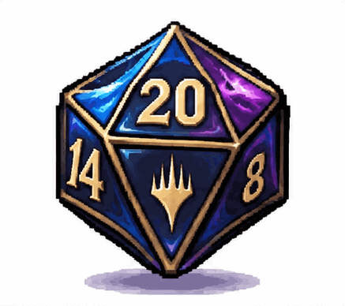
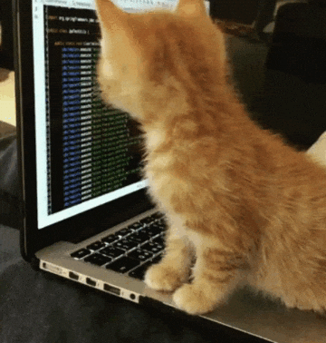

<h1 align="center">⚔️ Ciao, sono Ele! 🗡️</h1>

<!-- Il Cavaliere alla Panchina (Hollow Knight) -->

<!-- Il Cavaliere alla Panchina -->

  

  <i>"Tira un d20 su Percezione per esplorare il mio profilo..."</i>
  <!-- Animazione del dado che gira (d20) -->

  
  

---

### <i>📜 Note del Diario di Bordo <i>

- 🧙‍♂️ **Stato attuale:** Tentando un tiro di *Salvezza su Intelligenza* per far compilare il codice al primo colpo.
- 🗡️ **Arma preferita:** Ago e Chiodo da Cavaliere di Hallownest (e VS Code).
- 💬 **Chiedimi pure:** Come sconfiggere il Re dell' incubo Grimm o come fare il multiclasse perfetto su BG3.

--- 

### 🛡️ Inventario & Skill Tree (Linguaggi e Strumenti)

  

---

### ⚡ Status di Gioco

  <b>Mana / Energia Mentale:</b> 
  

